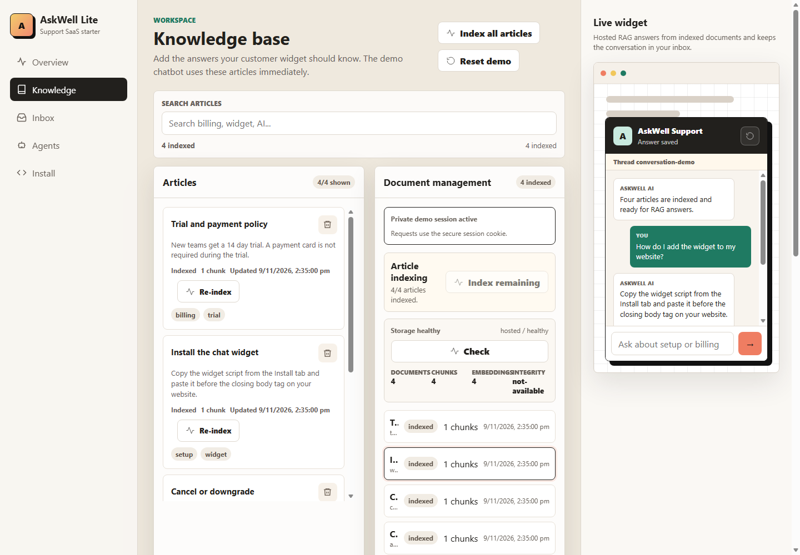
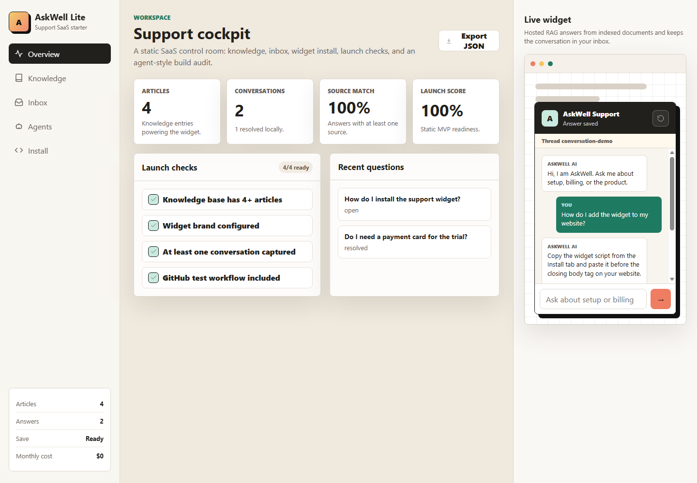
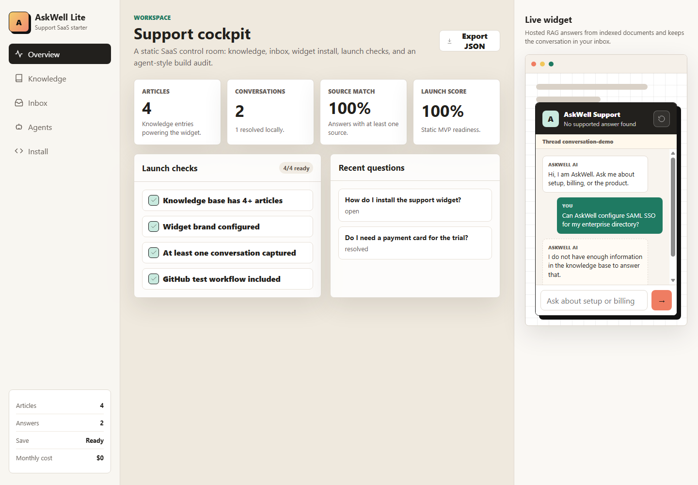
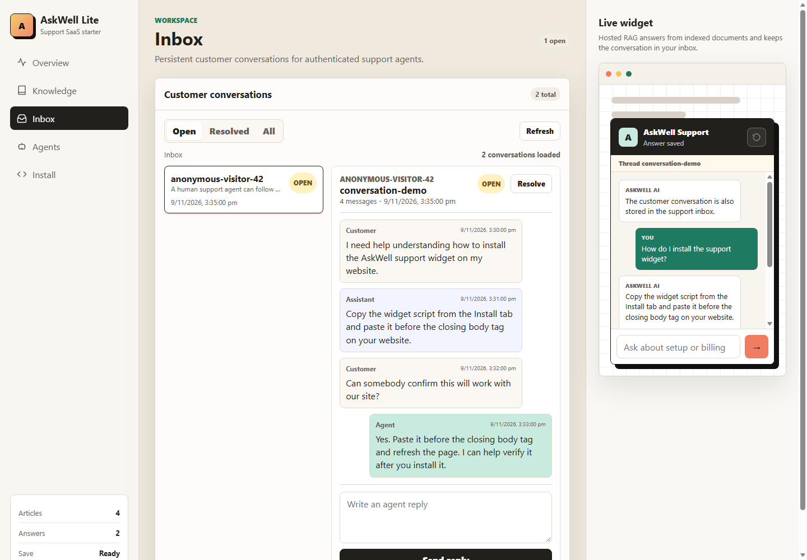
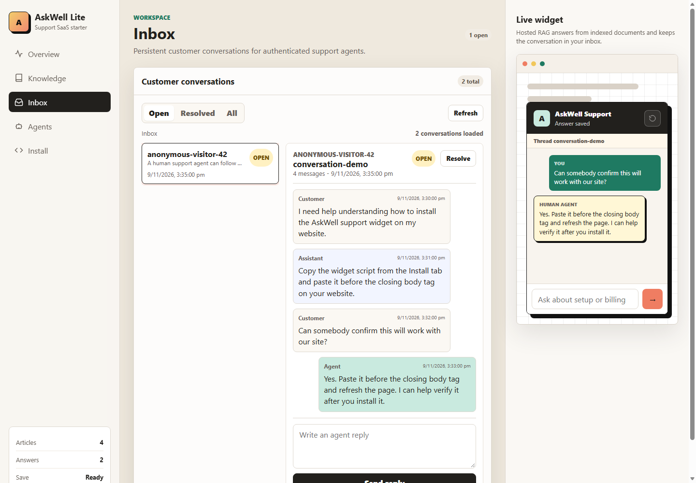
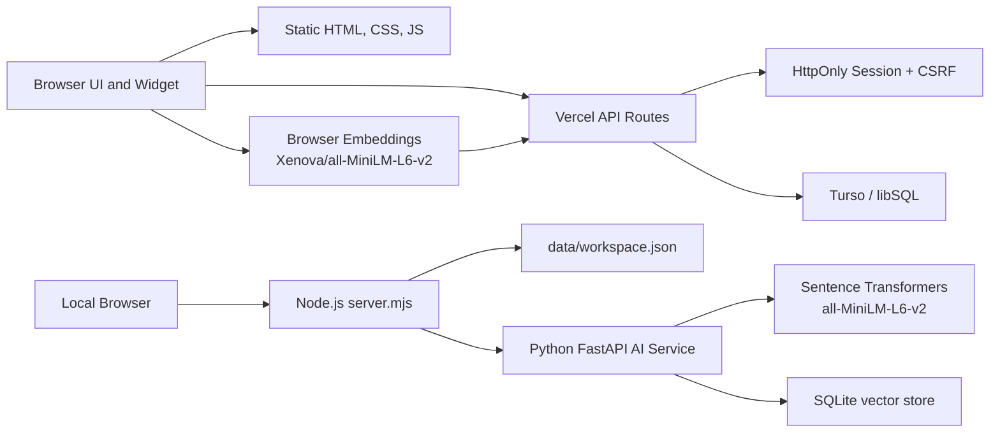
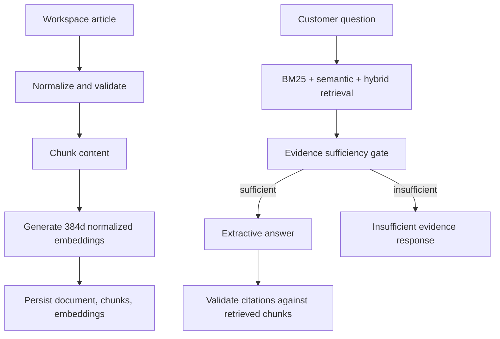
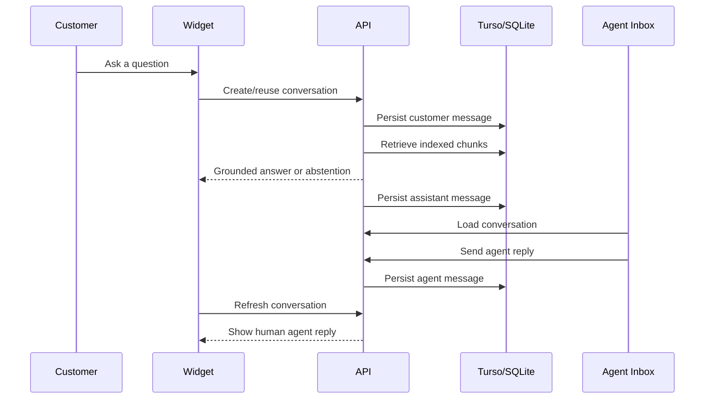

# AskWell Lite

<div align="center">

**A self-hostable AI customer-support MVP with knowledge-base RAG, persistent customer conversations, and a private hosted demo path.**

[](https://github.com/kasheeesh08/askwell-lite/actions/workflows/test.yml)


</div>

AskWell Lite started as a static support-chat starter and has grown into a compact customer-support SaaS prototype: a dashboard, editable knowledge base, hosted document indexing, retrieval-augmented answers with citations, persistent customer conversations, and an agent inbox. It is intentionally small enough to inspect end to end, while still exercising the pieces that make a real support product meaningful.

The project supports two operating modes:

- **Local full RAG:** Node.js dashboard plus an optional Python FastAPI AI service with Sentence Transformers and SQLite vector storage.
- **Hosted private demo:** Vercel serverless routes, Turso/libSQL persistence, browser-side embeddings, HttpOnly session authentication, and extractive grounded answers.

It is not marketed as public production infrastructure. It is an MVP/private-demo implementation with documented limits, regression tests, and a conservative upgrade path.

## Screenshots

<table>
  <tr>
    <td width="50%">
      
      <br />
      <sub><strong>Overview dashboard</strong> - workspace metrics, readiness checks, and live customer widget preview.</sub>
    </td>
    <td width="50%">
      
      <br />
      <sub><strong>Knowledge base</strong> - article management, indexing status, diagnostics, and document details.</sub>
    </td>
  </tr>
  <tr>
    <td width="50%">
      
      <br />
      <sub><strong>Customer chat</strong> - a grounded answer rendered with source attribution.</sub>
    </td>
    <td width="50%">
      
      <br />
      <sub><strong>Evidence abstention</strong> - unsupported questions receive an honest fallback instead of fabricated answers.</sub>
    </td>
  </tr>
  <tr>
    <td width="50%">
      
      <br />
      <sub><strong>Agent inbox</strong> - persistent conversations with customer, assistant, and agent messages.</sub>
    </td>
    <td width="50%">
      
      <br />
      <sub><strong>Agent reply</strong> - human replies appear with distinct attribution in the support workflow.</sub>
    </td>
  </tr>
</table>

## What It Does

- Manage support knowledge articles with create, edit, delete, search, import, export, and reset flows.
- Index workspace articles into a RAG knowledge base with per-article status, retryable failures, unchanged-content detection, and stable document IDs.
- Inspect indexed documents, chunk counts, content hashes, storage health, and diagnostics without exposing internal database paths.
- Answer customer questions with BM25, semantic retrieval, hybrid ranking, evidence sufficiency checks, grounded extractive generation, citations, and abstention.
- Persist customer conversations and message history separately from indexed knowledge documents.
- Provide an agent inbox with filters, chronological transcripts, agent replies, resolve/reopen actions, and sender attribution.
- Support a standalone embeddable widget script plus the in-app live widget preview.
- Protect hosted dashboard and document operations with server-side private-demo sessions, HttpOnly cookies, CSRF checks, and server-only secrets.
- Keep local development working without cloud services, paid AI calls, or production data.

## Architecture



The same product surface is kept intentionally plain: no React, no bundler, and no hidden managed backend. Browser modules live under `src/`, local server behavior lives in `server.mjs`, hosted serverless behavior lives in `api/` and `src/hosted/`, and the optional local AI service lives in `ai-service/`.

## RAG Pipeline



Implemented RAG behavior includes:

- Document ingestion with chunking, metadata, content hashes, duplicate detection, unchanged-document skipping, updates, deletion, and chunk/embedding cleanup.
- Local semantic embeddings through `sentence-transformers/all-MiniLM-L6-v2` in the Python service.
- Hosted browser embeddings through `Xenova/all-MiniLM-L6-v2` with `quantized: false`, 384 dimensions, mean pooling, and normalized vectors.
- BM25 retrieval, semantic vector retrieval, and hybrid Reciprocal Rank Fusion.
- Evidence sufficiency and abstention logic that uses lexical support, semantic relevance, retrieval agreement, query coverage, ambiguity checks, and conflict handling.
- Citation validation so displayed source references must come from retrieved evidence.

The hosted browser/Python embedding parity work showed strong compatibility for the tested English support-content corpus. Mixed-script Unicode parity was not established, so multilingual claims are intentionally avoided.

## Customer Support Flow



Customer conversations are stored separately from the knowledge base. Messages keep sender type (`customer`, `assistant`, `agent`), position, timestamps, conversation status, visitor identity, and workspace association. The current implementation supports conversation creation, message persistence, agent replies, resolve/reopen, and returning-visitor continuity through non-sensitive browser identifiers.

## Technology Stack

- **Frontend:** HTML, CSS, plain JavaScript modules.
- **Local backend:** Node.js HTTP server with static allowlisting, JSON workspace persistence, versioned saves, security headers, and optional FastAPI proxying.
- **Hosted backend:** Vercel serverless functions grouped to stay under the Hobby function limit.
- **Hosted storage:** Turso/libSQL through `@libsql/client`.
- **Local RAG service:** Python FastAPI, NumPy, Sentence Transformers, SQLite, and pytest.
- **Embeddings:** `sentence-transformers/all-MiniLM-L6-v2` locally; `Xenova/all-MiniLM-L6-v2` in the browser-hosted path.
- **Tests:** Node's built-in test runner plus focused browser automation through Microsoft Edge/Chromium CDP when available.

## Repository Map

```text
.
|-- api/                         # Vercel serverless entry points
|-- ai-service/                  # Optional local FastAPI RAG service
|-- docs/                        # Architecture notes, reports, and screenshots
|-- scripts/                     # Evaluation and browser-integration scripts
|-- src/
|   |-- app.js                   # Frontend bootstrap and routing
|   |-- api.js                   # Browser API client
|   |-- state.js                 # Frontend state and workflows
|   |-- hosted/                  # Hosted storage, routing, sessions, retrieval
|   |-- render/                  # Page renderers
|   `-- utils/                   # Escaping and validation
|-- tests/                       # Node regression suites
|-- askwell-widget.js            # Standalone embeddable widget
|-- index.html
|-- server.mjs                   # Local/self-hosted Node server
`-- styles.css
```

## Run Locally

Install Node dependencies:

```powershell
npm ci
```

Run the local dashboard:

```powershell
$env:NODE_ENV = "development"
npm start
```

Open:

```text
http://127.0.0.1:4173
```

The local Node server stores workspace state in `data/workspace.json`, which is intentionally ignored by Git. Static-only use also works by opening `index.html`, but server mode is the better path for persistence and API testing.

## Optional Local AI Service

The Python service is optional for local full-RAG validation.

```powershell
cd ai-service
py -m venv .venv
.\.venv\Scripts\Activate.ps1
pip install -r requirements.txt
$env:PYTHONPATH = "."
python -m uvicorn app.main:app --host 127.0.0.1 --port 8001
```

In another terminal:

```powershell
$env:NODE_ENV = "development"
$env:ASKWELL_AI_SERVICE_URL = "http://127.0.0.1:8001"
npm start
```

Optional protected service-to-service mode:

```powershell
$env:ASKWELL_AI_REQUIRE_TOKEN = "1"
$env:ASKWELL_AI_SERVICE_TOKEN = "<long random token>"
python -m uvicorn app.main:app --host 127.0.0.1 --port 8001
```

The browser never calls the local Python service directly.

## Hosted Private Demo

The hosted architecture is designed for a zero-cost private demo using Vercel Hobby and Turso Free, subject to each provider's current account and quota rules. It uses browser-side embeddings so the deployed app does not need to run Python, PyTorch, or Sentence Transformers on Vercel.

Required hosted environment variable names:

```text
ASKWELL_HOSTED_MODE=1
ASKWELL_ADMIN_TOKEN=<private demo access credential>
ASKWELL_SESSION_SECRET=<long random signing secret>
TURSO_DATABASE_URL=<server-side libSQL URL>
TURSO_AUTH_TOKEN=<server-side Turso token>
```

Security rules:

- The admin token and Turso token are server-side only.
- `/api/config` returns sanitized booleans and safe configuration only.
- Private hosted routes require a signed HttpOnly session cookie.
- State-changing hosted requests require CSRF validation.
- The private demo login exchanges the access credential for a short-lived session; it does not store the admin token in `localStorage` or frontend bundles.

Hosted mode currently uses five Vercel functions:

```text
api/config.mjs
api/workspace.mjs
api/auth.mjs
api/ai.mjs
api/conversations.mjs
```

`vercel.json` rewrites nested auth, AI, and conversation paths into those grouped handlers so the project stays under the Vercel Hobby function limit.

## Configuration

See `.env.example` for a copyable template. Important variables include:

```text
NODE_ENV
PORT
ASKWELL_ADMIN_TOKEN
ASKWELL_ALLOWED_HOSTS
ASKWELL_AI_SERVICE_URL
ASKWELL_AI_SERVICE_TOKEN
ASKWELL_HOSTED_MODE
ASKWELL_SESSION_SECRET
TURSO_DATABASE_URL
TURSO_AUTH_TOKEN
ASKWELL_LLM_PROVIDER
ASKWELL_LLM_MODEL
ASKWELL_LLM_BASE_URL
ASKWELL_LLM_API_KEY
```

LLM provider integration exists behind the Python AI service's provider interface, but live provider tests are opt-in. The default and hosted demo path are cost-conscious and do not require paid LLM calls.

## Testing and Evaluation

Core checks:

```powershell
npm run check
npm test
```

Browser integration harness:

```powershell
npm run test:browser
```

Hosted retrieval evaluation:

```powershell
node scripts/hosted-retrieval-eval.mjs
```

Python service tests:

```powershell
$env:PYTHONPATH = "ai-service"
pytest ai-service/tests -q
```

Recent tracked regression baselines include:

- Node checks passing.
- Node tests passing with the hosted route, storage, retrieval, embedding-parity, conversation, inbox, and smoke suites.
- Browser integration passing locally with Microsoft Edge/Chromium CDP in an environment that allows browser automation.
- Hosted retrieval evaluation passing on the synthetic fixture with answerable responses, abstention checks, and citation validation.
- Phase 6D production work verified the core private-demo flow after deployment fixes, while still documenting that public production readiness is not claimed.

The evaluation datasets are small and synthetic. They are useful for regression control and implementation confidence, not proof of broad production quality.

## Security Notes

AskWell Lite includes practical MVP hardening:

- Explicit static-asset allowlisting in local server mode.
- Blocked access to internal files such as `.git`, `data`, `.env`, `server.mjs`, tests, package files, and private folders.
- CSP, `X-Content-Type-Options`, `Referrer-Policy`, and `Permissions-Policy` headers.
- Malformed JSON and invalid request body handling.
- Versioned workspace writes and conflict handling.
- Server-only hosted credentials.
- Signed HttpOnly hosted sessions with expiry.
- CSRF checks for mutating hosted requests.
- Workspace isolation in storage APIs.

Known security and reliability limitations:

- Hosted rate limiting is still lightweight and instance-local.
- The private demo is single-owner; full auth, RBAC, account recovery, and audit trails are future work.
- Backup and restore for hosted Turso are operational tasks, not automated product features yet.
- Browser-side embedding requires downloading model assets from allowed CDN/model origins.

## Current Limitations

- The hosted demo is not a public multi-tenant SaaS.
- No Stripe billing, email, notification, analytics, assignment queue, or SLA workflow is included.
- Real LLM generation is optional and can cost money depending on provider configuration.
- The default hosted answer generation is extractive and grounded; it is intentionally conservative.
- Mixed-script multilingual embedding parity is not established.
- Browser model loading and caching must be verified in the target deployed browser/network environment.
- The app preserves raw workspace articles but does not store original uploaded files for later binary reprocessing.

## Why This Repo Is Useful

AskWell Lite is meant to be a credible portfolio project because it goes beyond a pretty static mockup:

- It has real persistence paths.
- It has indexing, deletion, update, and diagnostics flows.
- It has retrieval quality tests and evidence-gated abstention.
- It has private hosted auth instead of public dashboard access.
- It connects customer chat to a persistent support inbox.
- It documents trade-offs honestly instead of pretending to be a finished enterprise platform.

That makes it a strong foundation for the next upgrades: durable rate limiting, proper user accounts, team workspaces, richer analytics, queueing for ingestion, and production observability.

## License

MIT
