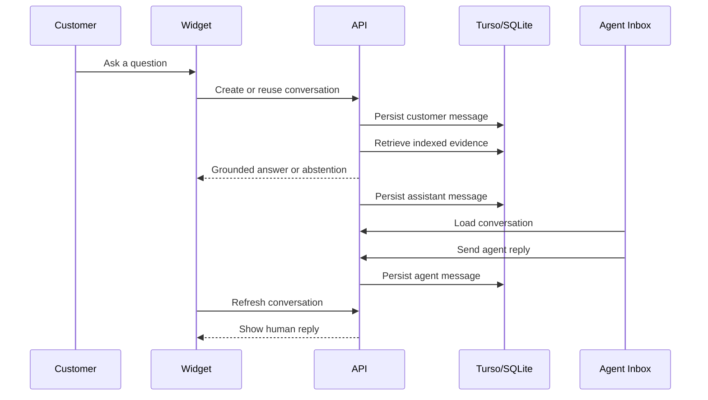
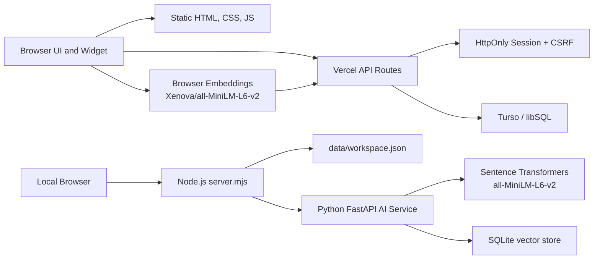
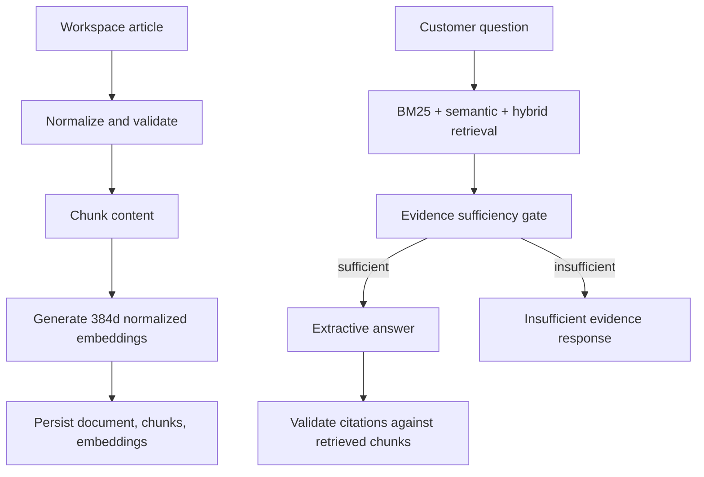

# AskWell Lite

<div align="center">

**A self-hostable AI customer-support MVP with RAG, citations, persistent conversations, and an agent inbox.**

[Open AskWell Lite](https://askwell-lite.vercel.app)<br />
**Hosted private demo - authentication required.**

[](https://github.com/kasheeesh08/askwell-lite/actions/workflows/test.yml)
[](https://github.com/kasheeesh08/askwell-lite)


</div>

AskWell Lite is a compact customer-support SaaS prototype. It combines a knowledge base, hosted document indexing, retrieval-augmented answers, source citations, persistent customer conversations, and a support-agent inbox in a small codebase that can be inspected end to end.

The project has two supported paths:

- **Local full RAG:** Node.js dashboard plus an optional Python FastAPI AI service, Sentence Transformers, and SQLite vector storage.
- **Hosted private demo:** Vercel serverless functions, Turso/libSQL persistence, browser-side embeddings, HttpOnly session authentication, and extractive grounded answers.

AskWell Lite is an MVP/private-demo implementation, not a public multi-tenant production SaaS. The README calls out verified behavior and limitations plainly.

## Contents

1. [Product Screenshots](#1-product-screenshots)
2. [Key Features](#2-key-features)
3. [Customer-Support Workflow](#3-customer-support-workflow)
4. [System Architecture](#4-system-architecture)
5. [RAG Pipeline](#5-rag-pipeline)
6. [Technology Stack](#6-technology-stack)
7. [Repository Structure](#7-repository-structure)
8. [Local Installation](#8-local-installation)
9. [Hosted Deployment Architecture](#9-hosted-deployment-architecture)
10. [Testing and Evaluation](#10-testing-and-evaluation)
11. [Security Implementation](#11-security-implementation)
12. [Current Limitations](#12-current-limitations)
13. [Project Status and License](#13-project-status-and-license)

## 1. Product Screenshots

<table>
  <tr>
    <td width="50%" valign="top">
      
      <br />
      <sub><strong>Overview dashboard</strong> - workspace metrics, readiness checks, and live customer widget preview.</sub>
    </td>
    <td width="50%" valign="top">
      
      <br />
      <sub><strong>Knowledge base</strong> - article management, indexing status, diagnostics, and document details.</sub>
    </td>
  </tr>
  <tr>
    <td width="50%" valign="top">
      
      <br />
      <sub><strong>Customer chat</strong> - a grounded answer rendered with source attribution.</sub>
    </td>
    <td width="50%" valign="top">
      
      <br />
      <sub><strong>Evidence abstention</strong> - unsupported questions receive an honest fallback instead of fabricated answers.</sub>
    </td>
  </tr>
  <tr>
    <td width="50%" valign="top">
      
      <br />
      <sub><strong>Agent inbox</strong> - persistent conversations with customer, assistant, and agent messages.</sub>
    </td>
    <td width="50%" valign="top">
      
      <br />
      <sub><strong>Agent reply</strong> - human replies appear with distinct attribution in the support workflow.</sub>
    </td>
  </tr>
</table>

## 2. Key Features

### Knowledge Management

- Article create, edit, delete, search, reset, import, and export flows.
- Bulk "Index all articles" onboarding for hosted RAG setup.
- Per-article indexing states: not indexed, indexing, indexed, and failed.
- Document details with source type, chunk count, timestamps, content hash, lifecycle status, re-indexing, and deletion.
- Storage diagnostics for health, backend type, indexed document count, chunk count, embedding count, and integrity status.

### AI and Retrieval

- BM25 keyword retrieval.
- Semantic vector retrieval.
- Hybrid ranking with Reciprocal Rank Fusion.
- Evidence sufficiency checks for weak evidence, ambiguity, conflicting evidence, and unsupported questions.
- Grounded extractive answers with citations tied to retrieved chunks.
- Abstention when the indexed knowledge base cannot support the answer.

### Customer Support

- Customer-facing chat widget and in-dashboard widget preview.
- Persistent customer conversations and chronological message history.
- Returning-visitor continuity through non-sensitive browser identifiers.
- Agent inbox with open/resolved filters, transcript view, agent replies, and resolve/reopen workflow.
- Clear sender attribution for customer, assistant, and human-agent messages.

### Security and Deployment

- Hosted private-demo authentication.
- Server-side admin credential, never bundled into browser code.
- Signed HttpOnly session cookies.
- CSRF protection for mutating hosted requests.
- Workspace-scoped storage APIs.
- Vercel + Turso hosted architecture that stays within the Vercel Hobby serverless-function limit.

## 3. Customer-Support Workflow



Customer messages, assistant answers, and human-agent replies are stored as conversation messages, separate from indexed knowledge documents. This keeps support history from being accidentally treated as retrieval source material.

## 4. System Architecture



AskWell Lite deliberately avoids a frontend framework and bundler. The frontend is plain JavaScript under `src/`, the local server is `server.mjs`, hosted serverless code is under `api/` and `src/hosted/`, and the optional local AI service is under `ai-service/`.

## 5. RAG Pipeline



Implemented retrieval behavior:

- Documents are normalized, chunked, embedded, and persisted with metadata and content hashes.
- Unchanged documents are skipped to avoid unnecessary re-embedding.
- Updated documents preserve stable IDs while replacing indexed chunks and vectors transactionally.
- Deleted documents remove associated chunks and embeddings through storage-layer cascades.
- Answer generation is extractive by default and only cites retrieved evidence.

Embedding paths:

- **Local:** `sentence-transformers/all-MiniLM-L6-v2`, 384 dimensions, normalized vectors.
- **Hosted:** `Xenova/all-MiniLM-L6-v2`, `quantized: false`, 384 dimensions, normalized vectors.

Browser/Python parity was validated for the tested English support-content corpus. Mixed-script Unicode parity was not established, so the project does not claim multilingual embedding compatibility.

## 6. Technology Stack

| Area | Implementation |
| --- | --- |
| Frontend | HTML, CSS, plain JavaScript modules |
| Local backend | Node.js HTTP server in `server.mjs` |
| Hosted backend | Vercel serverless functions under `api/` |
| Hosted storage | Turso/libSQL through `@libsql/client` |
| Local AI service | Python FastAPI |
| Local vector storage | SQLite, with JSON fallback retained for recovery/development |
| Embeddings | Sentence Transformers locally, Transformers.js in hosted browser mode |
| Testing | Node built-in test runner, pytest, and browser automation through Edge/Chromium CDP |

## 7. Repository Structure

```text
.
|-- api/                         # Vercel serverless entry points
|-- ai-service/                  # Optional local FastAPI RAG service
|-- docs/                        # Architecture notes, reports, and screenshots
|-- scripts/                     # Evaluation and browser-integration scripts
|-- src/
|   |-- app.js                   # Frontend bootstrap and routing
|   |-- api.js                   # Browser API client
|   |-- state.js                 # Frontend state and workflows
|   |-- hosted/                  # Hosted storage, routing, sessions, retrieval
|   |-- render/                  # Page renderers
|   `-- utils/                   # Escaping and validation
|-- tests/                       # Node regression suites
|-- askwell-widget.js            # Standalone embeddable widget
|-- index.html
|-- server.mjs                   # Local/self-hosted Node server
`-- styles.css
```

## 8. Local Installation

### 8.1 Run the Dashboard

1. Install Node dependencies.

   ```powershell
   npm ci
   ```

2. Start the local development server.

   ```powershell
   $env:NODE_ENV = "development"
   npm start
   ```

3. Open the app.

   ```text
   http://127.0.0.1:4173
   ```

The local Node server stores workspace state in `data/workspace.json`, which is ignored by Git. Static-only use by opening `index.html` still works, but server mode is better for persistence and API testing.

### 8.2 Run the Optional Python AI Service

1. Create and activate a virtual environment.

   ```powershell
   cd ai-service
   py -m venv .venv
   .\.venv\Scripts\Activate.ps1
   ```

2. Install Python dependencies.

   ```powershell
   pip install -r requirements.txt
   ```

3. Start FastAPI.

   ```powershell
   $env:PYTHONPATH = "."
   python -m uvicorn app.main:app --host 127.0.0.1 --port 8001
   ```

4. Point the Node server at the AI service from another terminal.

   ```powershell
   $env:NODE_ENV = "development"
   $env:ASKWELL_AI_SERVICE_URL = "http://127.0.0.1:8001"
   npm start
   ```

Optional service-to-service protection:

```powershell
$env:ASKWELL_AI_REQUIRE_TOKEN = "1"
$env:ASKWELL_AI_SERVICE_TOKEN = "<long random token>"
python -m uvicorn app.main:app --host 127.0.0.1 --port 8001
```

The browser never calls the local Python service directly.

## 9. Hosted Deployment Architecture

The hosted path is designed for a private demo on Vercel Hobby and Turso Free, subject to each provider's current account and quota rules. It does not deploy Python, PyTorch, or Sentence Transformers to Vercel. Hosted embeddings run in the browser and hosted persistence uses Turso/libSQL.

Required hosted environment variable names:

```text
ASKWELL_HOSTED_MODE=1
ASKWELL_ADMIN_TOKEN=<private demo access credential>
ASKWELL_SESSION_SECRET=<long random signing secret>
TURSO_DATABASE_URL=<server-side libSQL URL>
TURSO_AUTH_TOKEN=<server-side Turso token>
```

Hosted mode currently uses five Vercel functions:

```text
api/config.mjs
api/workspace.mjs
api/auth.mjs
api/ai.mjs
api/conversations.mjs
```

`vercel.json` rewrites nested auth, AI, and conversation paths into grouped handlers so the deployment remains below the Vercel Hobby 12-function limit.

Important hosted rules:

- The live deployment is a private demo and requires sign-in.
- The admin token, session secret, and Turso token stay server-side.
- `/api/config` exposes only sanitized booleans and safe operational status.
- Protected dashboard, diagnostics, document, answer, and conversation routes require a valid HttpOnly session.
- Mutating hosted requests require CSRF validation.

See `.env.example` for a local template. Do not commit real environment values.

## 10. Testing and Evaluation

Core checks:

```powershell
npm run check
npm test
```

Browser integration harness:

```powershell
npm run test:browser
```

Hosted retrieval evaluation:

```powershell
node scripts/hosted-retrieval-eval.mjs
```

Python service tests:

```powershell
$env:PYTHONPATH = "ai-service"
pytest ai-service/tests -q
```

Recent tracked baselines:

| Check | Status |
| --- | --- |
| Node syntax check | Passed |
| Node regression tests | Passed, including hosted route, storage, retrieval, embedding-parity, conversation, inbox, and smoke suites |
| Browser harness | Passed locally when Edge/Chromium CDP is available to the execution environment |
| Hosted retrieval evaluation | Passed on synthetic fixtures with answerable responses, abstention checks, and citation validation |
| GitHub Actions | Passing on `main` |

Representative hosted retrieval metrics from the synthetic evaluation fixture:

- Answer relevance: `0.9556`
- Citation validity: `1.0`
- Unanswerable abstention rate: `1.0`
- Ambiguous abstention rate: `1.0`

These metrics are regression signals for a small synthetic corpus. They should not be read as universal answer-quality guarantees.

## 11. Security Implementation

Implemented safeguards include:

- Explicit static-asset allowlisting in local server mode.
- Blocked access to `.git`, `data`, `.env`, `server.mjs`, tests, package files, and private folders.
- Content Security Policy, `X-Content-Type-Options`, `Referrer-Policy`, and `Permissions-Policy` headers.
- Malformed JSON and invalid request-body handling.
- Versioned workspace writes and conflict handling.
- Server-only hosted credentials.
- Signed HttpOnly hosted sessions with expiry.
- CSRF checks for mutating hosted requests.
- Workspace isolation in storage APIs.
- Sanitized hosted configuration responses that do not expose secrets.

The private demo is intentionally single-owner. Full user accounts, RBAC, team management, audit logs, and enterprise auth are future work.

## 12. Current Limitations

- The hosted app is not an unrestricted public demo; authentication is required.
- AskWell Lite is not a public multi-tenant production SaaS.
- Hosted rate limiting is lightweight and instance-local.
- Real LLM generation is optional and can cost money depending on provider configuration.
- The default hosted answer generator is extractive and conservative.
- Mixed-script multilingual embedding parity is not established.
- Browser model loading and caching still need verification in each target deployed browser/network environment.
- Some diagnostics are backend-specific; database integrity reporting can be unavailable for hosted Turso where SQLite-only checks do not apply.
- A previously observed hosted diagnostics count discrepancy is documented as a limitation until verified against the live deployment state.
- Original uploaded binary files are not stored for later reprocessing; AskWell stores normalized/indexed content and metadata.

## 13. Project Status and License

AskWell Lite has reached the Phase 6D private-demo milestone. The codebase includes the full customer-to-assistant-to-agent workflow, hosted authentication, RAG indexing, document lifecycle controls, conversation persistence, and regression coverage.

This repository is best viewed as a serious MVP foundation: useful enough to demo, small enough to understand, and honest about the gap between a private demo and a full production SaaS.

License: MIT
