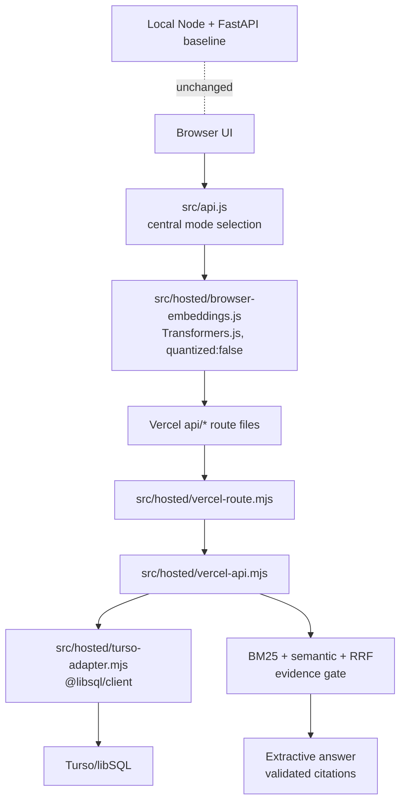

# Phase 4.3F Vercel Hosted Integration

Date: 2026-11-08

Scope: hosted application wiring only. No Turso account, hosted database, Vercel deployment, credit card, real workspace migration, live LLM call, Python baseline change, or production data modification was performed.

## Summary

Phase 4.3F turns the Phase 4.3E isolated hosted prototype into an actual Vercel-compatible project structure while keeping the existing local application path as the default.

Hosted mode is explicit:

```text
ASKWELL_HOSTED_MODE=1
```

Without that flag, the Vercel route wrappers fail closed with:

```json
{ "code": "hosted_mode_disabled" }
```

The local Node server, local JSON workspace persistence, Python FastAPI RAG service, and local SQLite vector store were not replaced.

## Architecture



## API Route Mapping

Actual Vercel-compatible route files were added under `api/`:

| Public route | Methods | Hosted handler route |
|---|---|---|
| `/api/config` | `GET` | public hosted/local mode config |
| `/api/workspace` | `GET`, `PUT` | `/api/hosted/workspace` |
| `/api/ai/health` | `GET` | `/api/hosted/health` |
| `/api/ai/diagnostics` | `GET` | `/api/hosted/diagnostics` |
| `/api/ai/ingest` | `POST` | `/api/hosted/ingest` |
| `/api/ai/answer` | `POST` | `/api/hosted/answer` |
| `/api/ai/documents` | `GET` | `/api/hosted/documents` |
| `/api/ai/documents/[id]` | `DELETE` | `/api/hosted/delete-document` |

The route files are thin wrappers. They reuse:

```text
src/hosted/vercel-route.mjs
src/hosted/vercel-api.mjs
src/hosted/turso-adapter.mjs
```

Business logic is not duplicated across the route files.

## Frontend Mode Selection

`src/api.js` now centralizes mode selection.

Default:

```text
local
```

Hosted mode can be selected by:

- server-returned `/api/config` with `apiMode: "hosted"`;
- `globalThis.ASKWELL_API_MODE = "hosted"` for custom static integration;
- `<meta name="askwell-api-mode" content="hosted">`;
- localStorage `askwell-api-mode=hosted` for tests/manual experiments.

The frontend still calls the same high-level API methods:

- `loadWorkspace`
- `saveWorkspace`
- `answerWithAi`
- `ingestDocuments`
- `listDocuments`
- `getDiagnostics`
- `deleteDocument`

The API layer handles hosted payload conversion, response normalization, and hosted embedding calls. UI modules do not need separate per-operation hosted branches.

## Browser Embedding Integration

Added:

```text
src/hosted/browser-embeddings.js
```

Validated Phase 4.2C configuration:

```text
Model: Xenova/all-MiniLM-L6-v2
Package: @xenova/transformers@2.17.2
Options: quantized: false
Pooling: mean
Normalization: true
Dimension: 384
```

The browser embedding module:

- dynamically imports the pinned Transformers.js package from jsDelivr;
- loads only `Xenova/all-MiniLM-L6-v2`;
- uses `{ quantized: false }`;
- chunks text with the hosted indexing profile;
- hashes normalized document and chunk text with browser `crypto.subtle`;
- validates vector dimension, finite values, and normalization before sending;
- sends only the approved embedding profile ID and compatibility key.

It does not silently fall back to another embedding model.

Known compatibility limitation: Phase 4.2C established strong English/support-content parity, not general multilingual or mixed-script parity.

## Database Client Decision

Decision: keep the current `@libsql/client` adapter for this phase.

Rationale:

- Phase 4.3E already implemented and tested the adapter contract with `@libsql/client`.
- The current adapter uses `createClient`, parameterized `execute`, local file URLs for tests, and interactive write transactions that are covered by automated tests.
- Migrating to Turso's newer `@tursodatabase/serverless` package would be a client swap, not a route-integration requirement.
- No real Turso remote database was available in this phase, so changing clients now would reduce confidence rather than increase it.

Important caveat: Turso's current docs recommend `@tursodatabase/serverless` for fresh serverless remote Turso apps. Before a real deployment, run a small adapter compatibility spike comparing transaction behavior, local-test support, error shapes, and Vercel runtime behavior.

## Configuration

Required hosted environment:

```text
ASKWELL_HOSTED_MODE=1
ASKWELL_ADMIN_TOKEN=<long random admin token>
TURSO_DATABASE_URL=<server-side Turso/libSQL URL>
TURSO_AUTH_TOKEN=<server-side Turso auth token>
```

Alternative explicit selector:

```text
ASKWELL_DEPLOYMENT_MODE=hosted
```

Local test mode can use a local `file:` libSQL URL without `TURSO_AUTH_TOKEN`.

Do not expose:

```text
TURSO_AUTH_TOKEN
ASKWELL_ADMIN_TOKEN
ASKWELL_LLM_API_KEY
```

## Vercel Configuration

Added:

```text
vercel.json
```

Headers include:

- `X-Content-Type-Options: nosniff`
- `Referrer-Policy: strict-origin-when-cross-origin`
- restrictive CSP with explicit allowances for the pinned Transformers.js CDN and model downloads;
- `Permissions-Policy` disabling camera, microphone, and geolocation.

The CSP avoids inline scripts and does not expose secrets. It allows:

```text
script-src 'self' https://cdn.jsdelivr.net
connect-src 'self' https://cdn.jsdelivr.net https://huggingface.co
worker-src 'self' blob:
```

### Production Runtime Fix

Date: 2026-11-09

Observed deployment error:

```text
Invalid export found in module "/var/task/server.mjs". The default export must be a function or server.
```

Root cause: the repository contains a root `server.mjs` local Node server and `package.json` keeps `start` pointed at `node server.mjs` for local/self-hosted mode. The hosted Vercel path is intentionally implemented by route files under `api/`, but the deployment package still included `server.mjs`, and `vercel.json` did not mark the project as a static/frontend-plus-functions deployment. That allowed Vercel's runtime detection to treat the local development server as a serverless entry module. `server.mjs` exports named local-server helpers and is not a Vercel Function default export, so production startup failed.

Correction:

- `server.mjs` is now excluded from the Vercel deployment artifact through `.vercelignore`.
- `ai-service/` is excluded entirely so the local Python FastAPI service cannot be packaged or inferred as a hosted function.
- `scripts/`, tests, docs, local databases, caches, virtual environments, and secrets remain excluded.
- `vercel.json` now sets `"framework": null` so the deployment is treated as a static frontend with explicit `api/` route functions rather than a framework/custom-server app.
- The actual Vercel functions remain the intentional files under `api/`, each of which imports `src/hosted/vercel-route.mjs` or `src/hosted/session-route.mjs`.

This does not change local mode. `npm start` still runs `server.mjs` locally.

## Security Review

Verified by code and tests:

- Hosted mode is disabled unless explicitly configured.
- Write routes require `ASKWELL_ADMIN_TOKEN`.
- Browser code never receives Turso URL/token.
- Browser code never receives LLM/API provider secrets.
- Workspace context is validated server-side.
- Document ownership is enforced by storage adapter and schema.
- Retrieval snapshots are workspace-scoped and embedding-profile-scoped.
- Request-size checks happen before persistence.
- Invalid vectors are rejected.
- Invalid embedding profile metadata is rejected.
- Browser-provided citations/scores are not accepted.
- Database failures return structured errors without credentials.
- Route wrappers apply basic security headers.

Not production-grade yet:

- durable hosted rate limiting;
- real account auth/RBAC;
- real multi-tenant isolation;
- real Vercel/Turso abuse testing;
- remote Turso transaction validation.

## Test Results

Focused route and hosted handler tests:

```text
node --no-warnings --test tests/hosted-vercel-routes.test.mjs tests/hosted-vercel-api.test.mjs
9 passed
```

Frontend/local smoke and hosted API-selection tests:

```text
node --no-warnings --test tests/smoke.test.mjs
48 passed
```

Hosted retrieval quality regression:

```text
node scripts/hosted-retrieval-eval.mjs
passed
```

Preserved hosted retrieval metrics:

| Metric | Value |
|---|---:|
| Answerable response rate | 1.0000 |
| Unanswerable abstention rate | 1.0000 |
| Ambiguous abstention rate | 1.0000 |
| Citation validity | 1.0000 |
| Top-5 ranking agreement | 1.0000 |

Full verification results are recorded after the final regression run.

Full verification:

```text
npm run check
passed
```

```text
npm test
104 passed
```

## Browser Verification

No Playwright or browser automation dependency is currently installed in this repository. I did not add one because this phase avoids unnecessary dependencies. I also attempted to inspect the existing in-app browser tab, but the browser-control policy blocked direct automation against the local `file://` URL.

The available automated UI coverage is the existing no-dependency DOM smoke harness in `tests/smoke.test.mjs`, which now covers:

- dashboard rendering;
- navigation;
- knowledge/document UI;
- diagnostics UI;
- chat/citations;
- insufficient-context/local fallback paths;
- install/widget pages;
- local mode regression;
- hosted-mode API selection;
- browser embedding model failure handling.

This is not a substitute for a real deployed browser test against Vercel and Turso.

## Remaining Blockers

- No real Turso database was contacted.
- No Vercel deployment was created.
- No real remote database transaction/concurrency behavior was validated.
- No durable hosted rate limiter exists.
- Hosted ingestion still sends JSON vectors and may hit Vercel's request-size limit for large documents.
- Browser model loading has not been tested in a deployed browser session in this phase.
- The hosted path is still text/article-oriented; PDF/DOCX browser ingestion remains deferred.
- No production authentication, RBAC, organizations, or customer-support inbox backend exists.

## Recommendation

Proceed to a small **real remote Turso/Vercel dry-run planning phase**, not a public launch.

Before deployment:

1. Decide whether to keep `@libsql/client` or switch to `@tursodatabase/serverless` after a focused remote-client comparison.
2. Add durable rate limiting or a strict public-preview abuse guard.
3. Test browser model loading and vector payload sizes in an actual deployed preview.
4. Validate remote Turso transactions and conflict behavior with concurrent requests.
5. Keep local full-RAG as the quality baseline.

Do not claim production readiness yet.
